# 新版论文补图位置与图注

共13张PNG，300dpi。标题编号为补图工作编号，插入正文后统一重排图号。原DOCX未修改。

## 补图01_多源数据月度完整性.png

插入位置：4.1.2末尾，放在“经过上述处理……”之后（建议正文）

图注：各组变量逐小时非缺失比例的月均值，2026年8月仅统计至27日；非仪器QC通过率。

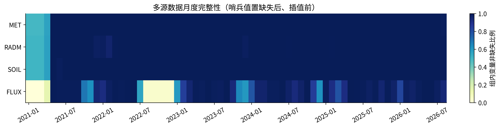

## 补图02_关键因素暖季经验分布.png

插入位置：4.3.1表4-1之后，放在“温度与大气水汽条件分析”之前（建议正文）

图注：本次数据处理后重算的五类指标72h均值与暖季经验分布。积温单位已转为℃·日；若与表4-1旧值不同，应更新表文，不能强改图值。

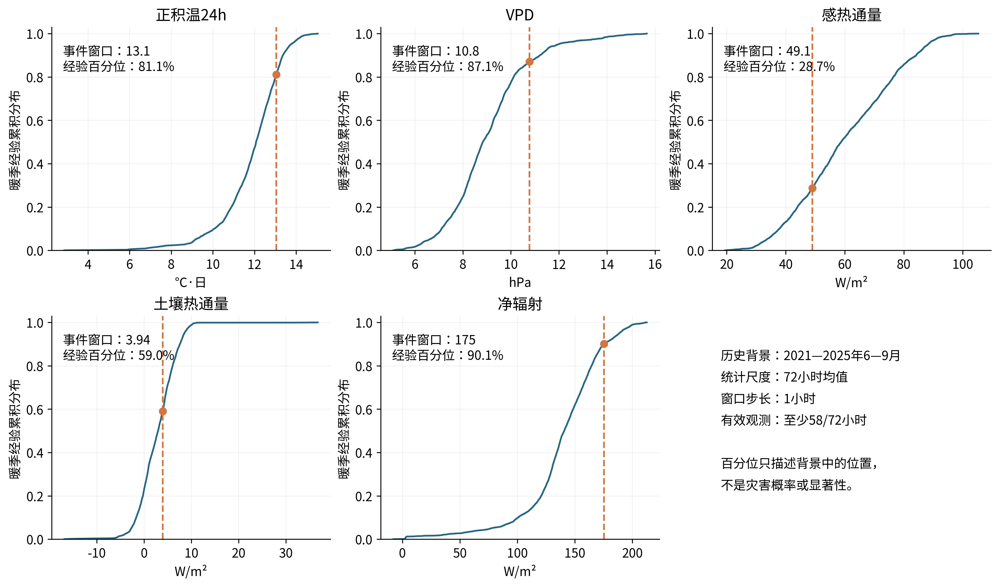

## 补图03_历史记录与独立事件日.png

插入位置：5.1.2最后一段之后（可选正文或附录）

图注：34条记录合并为19个日期；2021年32条记录对应17个日期。日期聚合避免共享气象过程被重复计样。

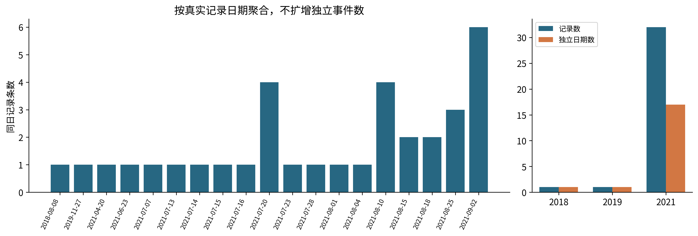

## 补图04_训练期报警阈值选择.png

插入位置：5.2.5最后一句“避免测试信息参与模型训练”之后（建议正文）

图注：按原项目设置重新拟合训练样本，Youden最大值确定阈值；测试标签不参与选阈值。

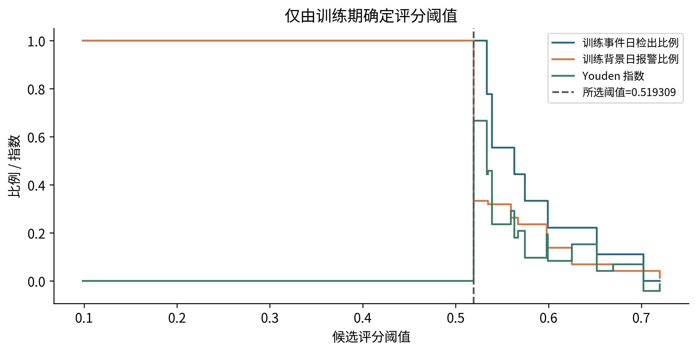

## 补图05_联合经验判别边界.png

插入位置：5.4.3末尾，“该判别边界仅适用于……”之后（建议正文）

图注：黑线为训练期评分阈值等值线；分别标出训练/测试及事件/背景样本，仅解释经验判别关系。

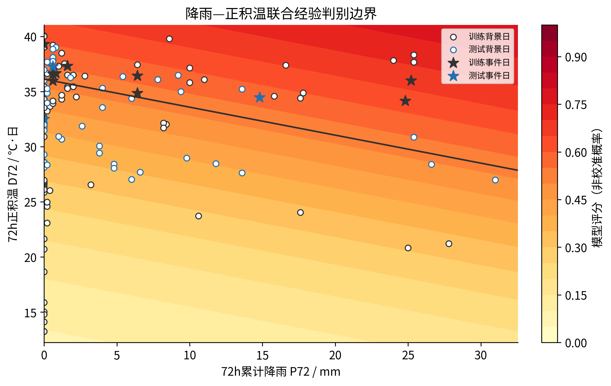

## 补图06_测试集混淆矩阵.png

插入位置：5.4.4表2-4之后；可与原表二选一（建议正文）

图注：测试事件日检出2/3，背景日报警14/43。右图按行归一化，避免类别不平衡掩盖漏报。

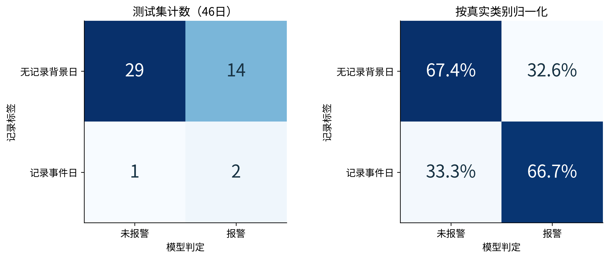

## 补图07_条件时间概率分布.png

插入位置：6.2.1式（6-11）及小时离散说明之后（建议正文）

图注：参数来自训练期校准与2026-08-25 10:00评分。连续公式端点用于解释分布，与程序整小时区间存在离散差异；不是实测起动时刻分布。

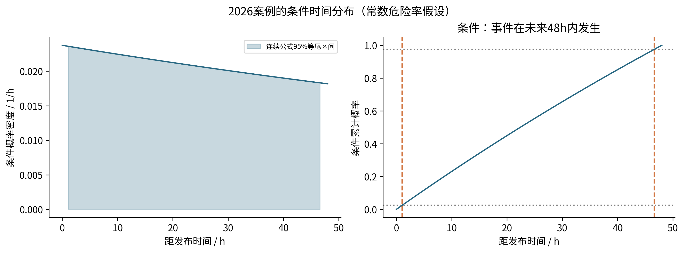

## 补图08_区间删失评价示意.png

插入位置：6.3.1覆盖率上下界公式之后（建议正文）

图注：灰带为已知的发生日期范围，蓝线为条件预测区间。示意时间段不代表真实事件，部分重叠不能判定真实小时已覆盖。

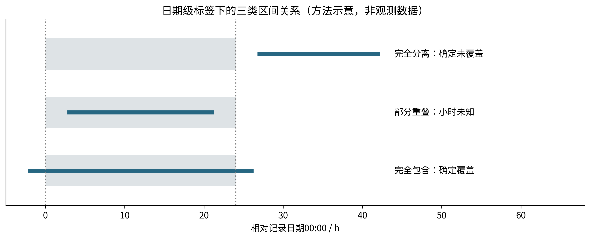

## 补图09_测试事件提前量区间.png

插入位置：6.4.2最后一段之后（建议正文）

图注：按覆盖该事件日期的48h预报发布计算提前量为[24,48)h；与正文“持续预警片段从8月16日开始”是不同口径，不能混用。

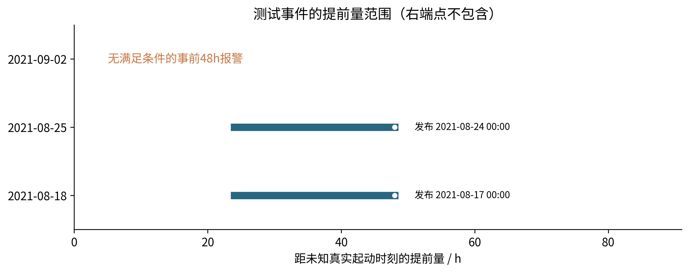

## 补图10_初始释放区域.png

插入位置：7.1.2末尾，紧接“图7-2给出……”（建议正文）

图注：补齐正文已引用但未嵌入的图7-2。释放区为数值近似，不是实测源区边界。

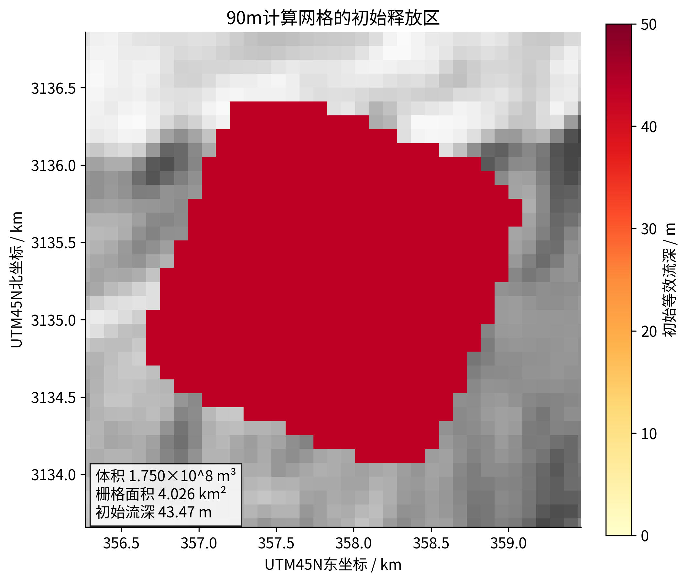

## 补图11_二维流深时空演化.png

插入位置：7.5.1式（7-20）之后、7.5.2之前（建议正文）

图注：90m主情景六个时刻流深，统一色标；蓝色三角为口岸参考点。模型输出不构成实测路径验证。

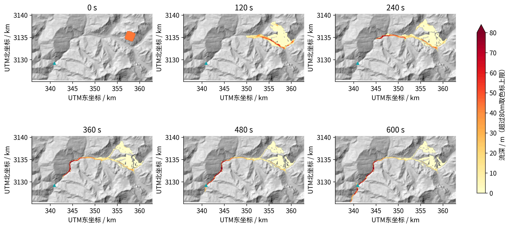

## 补图12_体积收支与数值残差.png

插入位置：第八章第一段之后，紧接体积残差−2.97×10⁻⁹的说明（建议正文）

图注：两条体积曲线近乎重合；残差小仅说明数值记账一致，不能替代动力学实测验证。

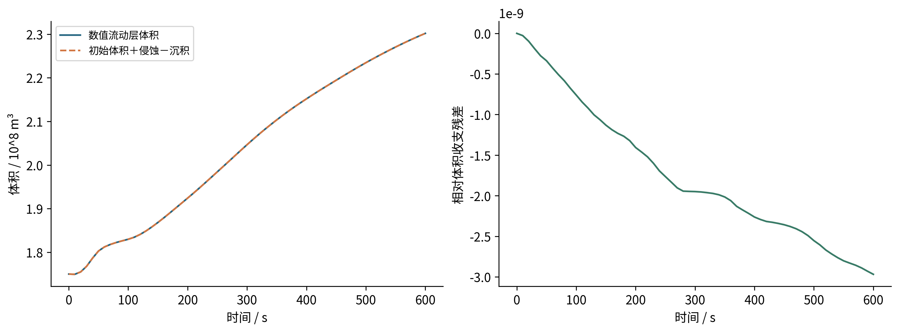

## 补图13_多指标网格敏感性.png

插入位置：第八章第二段“60m与90m……”之后（建议正文）

图注：两个网格采用相同参数和600s模拟时长。除到达时刻外，峰值速度和侵蚀量也对网格敏感；两种分辨率不足以证明数值收敛。

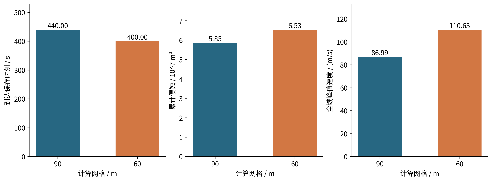